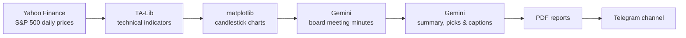

# Gemini Candlestick Investment Fund

[](https://github.com/thanatchon36/gemini-candlestick/actions/workflows/ci.yml)


An AI-simulated board meeting of legendary technical analysts. Every day it charts the S&P 500, asks Google Gemini to debate the charts as ten famous market technicians, and posts the meeting minutes, a summary, and the highlighted charts to Telegram.

[](https://www.youtube.com/watch?v=nJvH27cIxFo)

> 🏆 **Google Gemini API Developer Competition project.** [View the submission page](https://ai.google.dev/competition/projects/gemini-candlestick).

> [!WARNING]
> This is an educational simulation, **not financial advice**. The "Gemini Candlestick Investment Fund" is fictional, and its AI-generated analysis can be wrong.

## Table of Contents

- [How It Works](#how-it-works)
- [The Board of Directors](#the-board-of-directors)
- [Quick Start](#quick-start)
- [Configuration](#configuration)
- [Daily Schedule](#daily-schedule)
- [Project Structure](#project-structure)
- [Requirements](#requirements)
- [License](#license)

## How It Works



1. **Collect data:** downloads one year of daily prices for every S&P 500 stock with `yfinance`.
2. **Compute indicators:** RSI, MACD, Bollinger Bands, Fibonacci retracement, Ichimoku Cloud, Stochastic Oscillator, Chaikin Money Flow, On-Balance Volume, and ATR.
3. **Draw charts:** one candlestick chart per stock, with all indicators stacked below the price.
4. **Hold the meeting:** uploads the charts to Gemini and generates many candidate meeting minutes. It keeps the best one, then extracts the board's "Ticker Symbols of Interest" and writes a summary.
5. **Publish:** builds PDF reports and sends them to Telegram, along with captioned charts of the selected stocks.

## The Board of Directors

| Member | Speciality |
|---|---|
| **Munehisa Homma** (Chairman) | Candlestick pattern recognition |
| **John Bollinger** | Bollinger Bands |
| **Leonardo Pisano Fibonacci** | Fibonacci retracement levels |
| **Ralph Nelson Elliott** | Elliott Wave patterns, using Fibonacci ratios, RSI, MACD, and Bollinger Bands |
| **Goichi Hosoda** | Ichimoku Cloud |
| **Joseph Granville** | Volume and On-Balance Volume (OBV) |
| **Gerald Appel** | MACD |
| **J. Welles Wilder** | RSI and ATR |
| **George Lane** | Stochastic Oscillator |
| **Marc Chaikin** | Chaikin Money Flow |

## Quick Start

You need [Docker](https://docs.docker.com/get-docker/), a [Gemini API key](https://aistudio.google.com/apikey), and a Telegram bot ([setup guide](#telegram-setup)).

```bash
git clone https://github.com/thanatchon36/gemini-candlestick.git
cd gemini-candlestick
cp .env.example .env        # then fill in your keys
docker compose up -d --build
docker compose logs -f      # watch progress
```

Reports and charts are saved to `./data`.

<details>
<summary><strong>Run without Docker</strong></summary>

Requires Python 3.12 or newer. TA-Lib installs from a prebuilt wheel, so you don't need to compile it. To make PDFs, `weasyprint` needs the Pango library (`brew install pango` on macOS, `apt install libpango-1.0-0 libpangoft2-1.0-0` on Debian/Ubuntu).

```bash
python -m venv .venv && source .venv/bin/activate
pip install -r requirements.txt
set -a && source .env && set +a   # load keys from .env
python main.py
```

</details>

## Configuration

All settings live in `.env`, which git ignores. Never commit real keys.

| Variable | Required | Description |
|---|---|---|
| `GEMINI_API_KEY` | Yes | Google Gemini API key from [Google AI Studio](https://aistudio.google.com/apikey). |
| `BOT_TOKEN` | Yes | Telegram bot token. |
| `CHAT_ID` | Yes | Telegram channel or chat ID. |
| `GEMINI_MODEL` | No | Gemini model to use. Defaults to `gemini-3.8-flash`. |

### Telegram Setup

1. **Create a bot:** message [@BotFather](https://t.me/BotFather), send `/newbot`, and copy the token it gives you into `BOT_TOKEN`.
2. **Create a channel** and add your bot as an administrator (Channel Info → Administrators → Add Admin).
3. **Find the chat ID:** temporarily add [@RawDataBot](https://t.me/RawDataBot) to the channel and post a message. It replies with the channel ID, which usually starts with `-100`. Copy it into `CHAT_ID`, then remove `@RawDataBot`.

## Daily Schedule

The app runs continuously. Times are in UTC.

- **On start:** generates and sends a report straight away.
- **Each day at 00:04:** regenerates the charts and holds a new board meeting. Charts are not refreshed on Sunday and Monday, because the market was closed the day before.
- **About 02:00:** sends the PDF minutes and summary, then the highlighted charts in batches of up to 8.

## Project Structure

```
.
├── main.py                # Entry point: daily schedule and sending reports
├── candlestick/
│   ├── fund.py            # GeminiCandlestick: runs one daily cycle end to end
│   ├── market_data.py     # S&P 500 list and price download (yfinance)
│   ├── indicators.py      # RSI, MACD, Bollinger Bands, Ichimoku, Stochastic, CMF, OBV, ATR
│   ├── charts.py          # Candlestick chart drawing (matplotlib)
│   ├── prompts.py         # Gemini prompts for the board meeting
│   ├── gemini.py          # Gemini API wrapper and model settings
│   ├── parsing.py         # Cleaning minutes and extracting JSON from model output
│   ├── reports.py         # Markdown/images to PDF, merging PDFs
│   ├── telegram.py        # Telegram Bot API client
│   ├── clock.py           # UTC date and time helpers
│   ├── config.py          # Shared settings (paths, chart sizes, default model)
│   └── log.py             # Console logging
├── requirements.txt       # Pinned Python dependencies
├── Dockerfile             # Container image (ARM64 and x86_64)
├── docker-compose.yml     # Service definition, reads .env
└── .env.example           # Template for required settings
```

## Requirements

- **Hardware:** 2 CPU cores (ARM64 or x86_64), 2 GB RAM, 16 GB storage. Developed and tested on a MacBook M1.
- **Software:** Docker, or Python 3.12 or newer.

## License

This project was submitted to The Gemini API Developer Competition, sponsored by Google LLC. The submission is subject to the [Official Rules of the competition](https://ai.google.dev/competition), including the intellectual property provisions.
